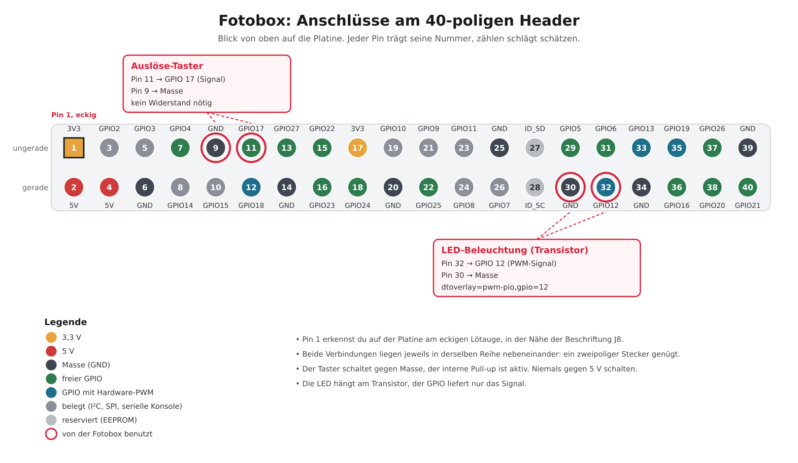

# GPIO & Hardware – Fotobox

Zielsystem: **Raspberry Pi 5** mit Raspberry Pi OS (64-bit).
Der Code läuft auch auf einem Pi 4, die Unterschiede fängt die Anwendung selbst ab.

---

## Überblick

Die Fotobox nutzt zwei GPIO-Funktionen:

| Funktion | Beschreibung | Konfiguration |
|---|---|---|
| Auslöse-Taster | Schließt den Kontakt → Foto | `Hardware.gpioLine` |
| LED-Beleuchtung | PWM-Signal auf einen Transistor | `Hardware.ledPwmChannel` |

---

## Anschlussplan



Erzeugt von [docs/make_pinout.py](docs/make_pinout.py). Ändert sich die
Verdrahtung, dort anpassen und neu erzeugen.

---

## Taster

### Verhalten
- Ein Tastendruck löst **immer** ein Foto aus, sofern gerade kein Countdown läuft
- Entspricht dem Signal `triggered()` der Klasse `Trigger`

### Verdrahtung
Standard ist **Taster gegen GND** mit internem Pull-up:

```
GPIO ──────┬────── Taster ────── GND
           │
    interner Pull-up (im SoC)
```

Ruhezustand ist damit High, das Drücken erzeugt eine **fallende Flanke**.
Bei kurzer Leitung – bis etwa einen Meter – ist ein externer Widerstand nicht nötig.

Alternativ Taster gegen 3,3 V: dann `"gpioPull": "down"` setzen, ausgewertet wird
die steigende Flanke.

> ⚠️ Niemals gegen 5 V schalten. Die GPIOs vertragen nur 3,3 V.

### Lange Leitung zum Taster

Der interne Pull-up hat etwa **50 kΩ**. Das genügt für ein kurzes Kabel, nicht
mehr für die paar Meter, die ein Taster am Stativ oder in der Hand braucht:

- Die Leitung bringt rund 50–100 pF je Meter mit. Bei 7 m sind das etwa 0,5 nF,
  die der schwache Pull-up über einige zehn Mikrosekunden laden muss – die
  Flanke wird flach.
- Vor allem aber ist eine Leitung mit 50 kΩ Quellwiderstand eine gute Antenne.
  Netzbrummen, ein Blitz oder ein Schaltnetzteil in der Nähe reichen, um den
  Eingang mehrfach über die Schaltschwelle zu ziehen. In `--gpio-watch` sieht
  das wie ein prellender Taster aus, ist aber Einstreuung.

Dagegen hilft ein externer Pull-up am **Pi-Ende**, zusammen mit einem Tiefpass:

```
              3,3 V (Pin 1)
                  │
                 2,2 kΩ            externer Pull-up
                  │
GPIO 17 (Pin 11) ─┼── 330 Ω ──────────── Taster ──┐
                  │                                │  7 m, verdrillt
               100 nF                              │
                  │                                │
GND (Pin 9) ──────┴────────────────────────────────┘
```

- **2,2 kΩ nach 3,3 V** senkt den Quellwiderstand um mehr als das Zwanzigfache.
  Erlaubt ist alles von 1 kΩ bis 4,7 kΩ; bei 2,2 kΩ fließen im gedrückten
  Zustand 1,5 mA.
- **100 nF vom Pin nach GND** glättet Spitzen. Mit dem Pull-up ergibt das beim
  Loslassen rund 220 µs, über den Vorwiderstand beim Drücken rund 33 µs.
- **330 Ω in Reihe** hält den Pin aus der 7 m langen Antenne heraus und
  begrenzt den Strom bei einer statischen Entladung am Taster.
- Beide Bauteile gehören **an den Pi**, nicht an den Taster.
- Die Hin- und Rückleitung **verdrillen** und als Rückleitung den GND-Pin direkt
  daneben nehmen (Pin 9 liegt neben Pin 11). Nicht parallel zu Netz- oder
  Blitzleitungen verlegen. Bei geschirmtem Kabel den Schirm nur am Pi auf GND.

Mit externem Pull-up kann `"gpioPull": "none"` gesetzt werden; der interne
Widerstand liegt sonst einfach parallel, was nicht stört.

### Implementierung
- Klasse `TriggerGpio`
- Spricht `/dev/gpiochipN` direkt über die Kernel-Schnittstelle **uAPI v2** an
- Dadurch keine Abhängigkeit zu `libgpiod`, dessen API sich zwischen Version 1 und 2
  grundlegend unterscheidet
- Entprellt bevorzugt **im Kernel**; kann der Treiber das nicht, übernimmt es die Anwendung
- Läuft ereignisgesteuert über den Qt-Eventloop, kein eigener Thread, kein Polling

### Chip-Nummer
Die Nummer von `/dev/gpiochipN` ist **nicht stabil**: auf dem Pi 4 ist der Header
`gpiochip0`, auf dem Pi 5 je nach Kernel `gpiochip0` oder `gpiochip4`.
Deshalb steht `"gpioChip": "auto"` in der Konfiguration. Die Anwendung sucht den Chip
anhand seines Labels (`pinctrl-rp1` auf dem Pi 5, `pinctrl-bcm2711` auf dem Pi 4).

---

## Pin-Nummer herausfinden

Wenn die Belegung einer vorhandenen Verdrahtung unbekannt ist:

```bash
fotobox --gpio-info     # alle Leitungen mit Name und Belegung
fotobox --gpio-watch    # zusätzlich: Flanken anzeigen
```

`--gpio-watch` beobachtet alle freien Header-Leitungen mit internem Pull-up.
Taster drücken, die Ausgabe nennt BCM-Nummer und Pin am Header:

```
20:13:44.218  BCM 17 (Pin 11)  fallend (gedrueckt)
20:13:44.396  BCM 17 (Pin 11)  steigend (losgelassen)   178 ms nach der vorigen Flanke
```

Die Zeiten stammen aus dem Kernel, nicht vom Zeitpunkt der Ausgabe, und sind
deshalb auch bei einer unruhigen Leitung belastbar. Gemeldet wird alle 250 ms
gesammelt. Prellt es, steht dort statt der einzelnen Flanken eine Zeile wie:

```
20:13:44.468  BCM 17 (Pin 11)  83 Flanken in 240 ms (42 fallend, 41 steigend), kuerzester Abstand 0.30 ms  -> prellt
```

Das ist der Normalfall bei einem mechanischen Taster an langer Leitung, siehe
[Lange Leitung zum Taster](#lange-leitung-zum-taster). Diese Anzeige entprellt
absichtlich nicht; im Betrieb hält die Anwendung nach jeder gemeldeten Flanke
400 ms Nachlauf, in denen weitere Flanken nur weggelesen werden.

Beide Modi brauchen keinen Bildschirm und laufen auch über SSH.

---

## LED-Beleuchtung

Das LED-Band bringt Vorwiderstände mit und wird über einen Transistor geschaltet.
Der Pi liefert nur das **PWM-Signal** an die Basis bzw. das Gate.

### Auf dem Pi 5
`pwm-pio` nutzt die programmierbare IO-Einheit des RP1 und läuft auf **jedem**
GPIO von 0 bis 27, hardware-getaktet:

```
dtoverlay=pwm-pio,gpio=12
```

Die Pinwahl ist damit frei. Bis zu vier solcher Ausgänge sind möglich, solange
nichts anderes die PIO-Einheit belegt.

### Auf dem Pi 4 und älter
Der PWM-Block des SoC bedient nur vier Pins:

| GPIO | Header-Pin | Eintrag |
|---|---|---|
| 12 | 32 | `dtoverlay=pwm,pin=12,func=4` |
| 13 | 33 | `dtoverlay=pwm,pin=13,func=4` |
| 18 | 12 | `dtoverlay=pwm,pin=18,func=2` |
| 19 | 35 | `dtoverlay=pwm,pin=19,func=2` |

### Überall
`dtoverlay=pwm-gpio,gpio=N` erzeugt die PWM im Kernel per Software. Das geht auf
jedem Pin, ist aber am ungenauesten und nur die Notlösung.

In allen drei Fällen ist die Ansteuerung identisch, die Fotobox merkt keinen
Unterschied. `pigpio` funktioniert auf dem Pi 5 übrigens nicht mehr.

Ein konkreter Belegungsvorschlag steht in der [README](README.md#-vorgeschlagene-pinbelegung).

### Aktivieren
In `/boot/firmware/config.txt` eintragen und neu starten:

```
[all]
dtoverlay=pwm-pio,gpio=12
```

Die erlaubten Parameter listet `dtoverlay -h pwm-pio` auf dem Pi selbst auf.

Prüfen:

```bash
ls /sys/class/pwm/        # muss mindestens einen pwmchip zeigen
cat /sys/class/pwm/pwmchip0/npwm
```

### Implementierung
- Klasse `LedPwm`, steuert `/sys/class/pwm/pwmchipN/pwmM`
- `"ledPwmChip": -1` sucht den passenden Chip selbst, da die Nummer je nach
  Kernel und Overlay wechselt
- Frequenz über `"ledPwmFrequency"`, Standard 1000 Hz
- Helligkeit 0–100 % als Einschaltdauer, einstellbar im Menü der Anwendung
- Beim Beenden wird die LED ausgeschaltet

### Mehrere PWM-Chips

Auf dem Pi 5 liegen in der Regel zwei Chips nebeneinander:

| Chip | Gerät | Bedeutung |
|---|---|---|
| `pwmchip0` | `1f0009c000.pwm` | Hardware-Block des RP1, oft für den Lüfter |
| `pwmchip1` | `pwm_pio@c` | vom Overlay `pwm-pio` angelegt, **der richtige** |

Die Fotobox bevorzugt automatisch den `pwm_pio`-Chip und protokolliert beim Start
alle gefundenen. Greift sie daneben, legt `"ledPwmChip"` den richtigen fest.

```bash
ls -l /sys/class/pwm/        # zeigt, welcher Chip zu welchem Gerät gehört
```

---

### Rechte
Der Benutzer muss in der Gruppe `gpio` sein, sonst sind weder `/dev/gpiochip*`
noch `/sys/class/pwm` beschreibbar:

```bash
sudo usermod -aG gpio "$USER"   # danach neu anmelden
```

---

## Touchscreen
- Touch ist **kein GPIO**
- Wird über Qt-Events erkannt
- Touch beendet nur die Slideshow und löst **nie** ein Foto aus

---

## Sicherheit
- GPIOs niemals direkt im UI-Thread pollen; hier löst der Kernel das über Ereignisse
- Entprellen beachten, Standard sind 30 ms (`"gpioDebounceMs"`); dazu kommen
  400 ms Nachlauf nach jedem gemeldeten Druck
- Die Last des LED-Bands läuft über den Transistor, nicht über den GPIO
